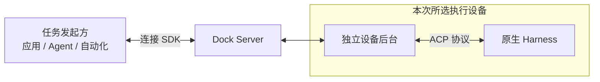

# harness-dock

**让原生 Harness，为你的产品执行任务。**

通过 SDK 连接获授权的设备，复用已有的原生安装、登录和工具环境。由你的产品选择执行设备、发起任务，并接回进度、原生审批和产物；执行留在所选设备上。

Harness Dock 是面向原生 Harness 的 AI Infra，负责跨设备接入、连接与执行管理。应用负责业务交互、业务授权与结果验收，Harness 负责内部工具与原生权限。

[从 SDK 示例开始](https://hutian-ai.github.io/harness-dock/sdk/#first-task) · [产品文档](https://hutian-ai.github.io/harness-dock/) · [App 使用指南](https://hutian-ai.github.io/harness-dock/app/) · [下载 macOS 客户端](https://github.com/hutian-ai/harness-dock/releases/download/v0.1.2/harness-dock-panel-0.1.2-darwin-arm64.zip) · [版本说明](https://github.com/hutian-ai/harness-dock/releases/tag/v0.1.2)

## 适合谁

你在开发业务产品、Agent 或自动化服务，需要把任务交给其他设备上的原生 Harness，并希望复用设备接入与执行管理。

例如，为业务产品加入“生成报告”入口：产品选择获授权且具备所需能力的电脑，提交任务，接收原生审批与进度，再取回报告并按业务规则验收。具体工具能力取决于所选设备的原生环境和权限。

**应用开发者：**[下载 SDK 0.1.0](https://github.com/hutian-ai/harness-dock/releases/tag/sdk-v0.1.0)，按[第一个真实任务](https://hutian-ai.github.io/harness-dock/sdk/#first-task)下载、校验和离线安装，把文本笔记整理为 Markdown 报告。首次示例使用发行内的 Server 和独立开发者 Daemon，无需先安装设备 App，也不复用已有 App 后台。SDK、server 和 macOS arm64 开发者 Daemon 均提供带依赖归档，无需克隆仓库或构建源码。

## 它怎么工作

1. **产品选设备**：通过连接 SDK 查询获授权设备的在线状态与可用能力，选择本次执行设备。
2. **设备执行任务**：Server 转发请求，独立 Daemon 持有进程和执行记录，原生 Harness 使用这台设备已有的安装、登录、工具和环境。
3. **结果回到产品**：进度、原生审批和产物沿原路返回，产品负责呈现交互与验收结果。

同一 Server 可接入多台设备，图中展开本次所选设备。设备主动连接服务端，无需为设备开放公网入站端口；远程连接使用经过验证的 WSS。

应用断线后按原任务查询进度和结果，重连不会自动重派任务。依赖应用响应的交互仍可能失败；Daemon 重启不会自动恢复执行，缺少完成证据时保持待核对。详见[执行生命周期](https://hutian-ai.github.io/harness-dock/lifecycle/)。

## 什么时候值得使用 Dock

| 你的目标 | 可以从哪里开始 |
| --- | --- |
| 自己远程使用一个 Harness | 先看原生远程入口，直接使用原生客户端完成任务。 |
| 直接集成某个 Harness，且已有所需的设备连接与进程管理 | 原生 SDK 或服务接口可能更轻。 |
| 让自己的产品调用其他设备上的原生环境，并复用设备接入与执行管理 | 使用 Dock 的连接 SDK、自托管 Server 和独立设备 Daemon。 |

Dock 封装的是设备接入与跨设备执行管理。会话、审批和事件本身并非 Dock 独有；接入方需要维护连接服务与设备后台。完整对比见[如何选择远程控制、原生 SDK 与 Dock](https://hutian-ai.github.io/harness-dock/overview/#when-to-use)。

## 开始使用

- **应用开发者**：[从 SDK 示例发起第一个任务](https://hutian-ai.github.io/harness-dock/sdk/#first-task)，学习选设备、发任务、收进度与产物。
- **设备用户**：[下载 macOS 客户端](https://github.com/hutian-ai/harness-dock/releases/download/v0.1.2/harness-dock-panel-0.1.2-darwin-arm64.zip)，按 [App 使用指南](https://hutian-ai.github.io/harness-dock/app/)完成首次连接、查看状态、按需测试和日常维护；详细安装要求见[安装指南](https://hutian-ai.github.io/harness-dock/installation/)。
- **服务管理员**：[部署连接服务](https://hutian-ai.github.io/harness-dock/server/)，为应用与执行设备准备共同的入口。

设备接入路径是：取得管理员邀请 → 安装客户端 → 用邀请连接这台 Mac → 确认状态并回到提供邀请的应用。实际执行前安装并登录所选原生 Harness；需要核验时点击首页的 Harness 条目，在详情中运行诊断或固定回显。客户端 App 自带运行时和独立后台 Daemon，后台管理这台 Mac 上的原生执行；收起或退出 App 后，后台仍可继续运行。测试使用模型额度，通过不代表全部工具或业务授权均已验证。没有邀请的开发者先走 SDK 示例，管理员先部署 Server 并生成邀请。

当前 App 为 **v0.1.2 Developer Alpha**，仅有 ad-hoc 签名，尚未完成 Developer ID 签名与 Apple 公证，macOS 可能阻止首次打开；安装限制见[版本说明](https://github.com/hutian-ai/harness-dock/releases/tag/v0.1.2)，遇到限制可[联系维护者](https://github.com/hutian-ai/harness-dock/issues)。

## 支持哪些 Harness

App 与开发者 SDK 分别发行。App `v0.1.2` 面向设备用户；SDK `sdk-v0.1.0` 提供连接 SDK、Server 与独立开发者 Daemon。设备执行均限 macOS arm64。

| 原生 Harness | App v0.1.2 | SDK sdk-v0.1.0 |
| --- | --- | --- |
| Codex | 已支持：macOS 13+、Apple Silicon | 已支持：macOS arm64 |
| dsh（DeepSeek Harness） | 实验适配：macOS arm64，复用本机 dsh | 实验适配：macOS arm64，复用本机 dsh |
| zcode | 计划接入 | 计划接入 |
| opencode | 计划接入 | 计划接入 |

具体工具能力取决于原生环境和权限。完整平台与能力边界见[支持范围](https://hutian-ai.github.io/harness-dock/support/)。

应用通过 SDK 的 `provider: 'dsh'` 调用实验适配，可连接 App 安装的设备后台或 SDK 发行内的独立开发者 Daemon；设备需安装并配置原生 `@deepseek-ai/dsh`，首个适配版本为 `0.1.2-rc.1`。模型值从设备 inventory 原样选择。原生审批保留 `optionId`，支持会话续接；暂不提供精确最终答案识别或只读结果查回，重启未完成的执行保持 `unknown`。配置与示例见[驱动页](https://hutian-ai.github.io/harness-dock/drivers/)。

App `v0.1.2` 首页突出已检测到的 Harness 数量、安装列表和服务连接；点击 Codex/dsh 条目查看安装信息、固定回显与各自历史。“设置与维护”收纳日志、版本、自启和后台操作，右上角按钮只收起面板。详细操作见 [App 使用指南](https://hutian-ai.github.io/harness-dock/app/)。Codex 固定回显使用原生只读模式；dsh 固定回显沿用原生权限配置，不提供只读保证。测试使用模型额度，不代表工具或应用授权已验收。替换 App 不会自动更新已经安装的后台；需要新版后台能力时，在“设置与维护”中显式更新后台。

维护者可运行 `pnpm accept:dsh`，通过本机隔离的 SDK / Server / DeviceHost fixture 验收原生审批允许、拒绝、取消后旧决定失效、一次性授权作用域、MCP 成功/错误与送达、调用方和原生项目 skills 共存。会实际使用模型额度，证据保存在 ignored `.local/dsh-acceptance-*`；本机合成验收不替代独立设备、独立 Daemon 进程或发行包验收。

## 开发与贡献

源码构建和验证见[开发指南](https://hutian-ai.github.io/harness-dock/verification/)，深入了解 [架构](https://hutian-ai.github.io/harness-dock/architecture/) 与 [ACP 分层](https://hutian-ai.github.io/harness-dock/drivers/)。贡献约定见 [CONTRIBUTING.md](CONTRIBUTING.md)。

源码采用 [MIT](LICENSE)，依赖许可见[第三方说明](THIRD_PARTY_NOTICES.md)。workspace 包保持 private，未发布到 npm。安全问题按 [SECURITY.md](SECURITY.md) 私下报告。
