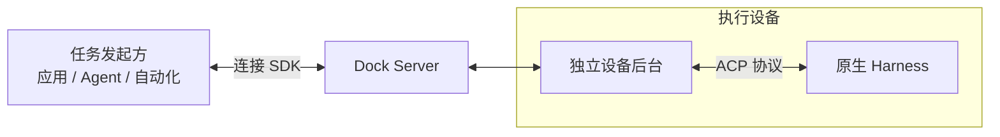

# harness-dock

**让你的应用，调用原生执行能力。**

让应用、Agent 和自动化服务通过 SDK 调用其他机器上的原生 Harness，将任务、原生审批和结果接入自己的业务流程。Harness Dock 封装设备接入与执行管理，复用原生安装、登录和工具环境；应用负责业务交互、授权与结果验收。

[下载 macOS 客户端](https://github.com/hutian-ai/harness-dock/releases/download/v0.1.0/harness-dock-panel-0.1.0-darwin-arm64.zip) · [文档站](https://hutian-ai.github.io/harness-dock/) · [版本说明](https://github.com/hutian-ai/harness-dock/releases/tag/v0.1.0)

**应用开发者：**[下载 SDK 0.1.0](https://github.com/hutian-ai/harness-dock/releases/tag/sdk-v0.1.0)，按[第一个真实任务](https://hutian-ai.github.io/harness-dock/sdk/#first-task)下载、校验和离线安装，在独立设备后台上把文本笔记整理为 Markdown 报告。SDK、server 和 macOS arm64 开发者 Daemon 均提供带依赖归档，无需克隆仓库或构建源码。

## 它怎么工作

设备主动连接服务端，任务、权限确认和结果沿连接双向传递。应用负责业务交互与结果验收，原生 Harness 负责执行与工具权限。

## 支持哪些 Harness

统一接入不同 Harness 是产品方向，当前已发布安装包只包含 Codex；源码新增 dsh 的 SDK 实验接入。

| 原生 Harness | 支持状态 |
| --- | --- |
| Codex | 已支持：macOS 13+、Apple Silicon |
| dsh（DeepSeek Harness） | 源码实验接入：macOS arm64，复用本机 dsh；未更新已发布安装包 |
| zcode | 计划接入 |
| opencode | 计划接入 |

具体工具能力取决于原生环境和权限。完整平台与能力边界见[支持范围](https://hutian-ai.github.io/harness-dock/support/)。

dsh 实验入口复用现有 SDK 的 `provider: 'dsh'`；设备需安装并配置原生 `@deepseek-ai/dsh`，首个适配版本为 `0.1.2-rc.1`。模型值从设备 inventory 原样选择。原生审批保留 `optionId`，支持会话续接；暂不提供精确最终答案识别或只读结果查回，重启未完成的执行保持 `unknown`。源码与新构建候选在“检查本机环境”中逐项展示后台发现结果（当前支持 Codex/dsh），按需进行固定回显并分别保存历史。Codex 使用原生确认的只读模式；dsh 沿用原生权限配置，不提供只读保证。测试使用模型额度，也不代表工具或应用授权已验收。现有 v0.1.0 下载仍使用原来的 Codex 测试界面。配置与示例见驱动页。

维护者可运行 `pnpm accept:dsh`，通过本机隔离的 SDK / Server / DeviceHost fixture 验收原生审批允许、拒绝、取消后旧决定失效、一次性授权作用域、MCP 成功/错误与送达、调用方和原生项目 skills 共存。会实际使用模型额度，证据保存在 ignored `.local/dsh-acceptance-*`；本机合成验收不替代独立设备、独立 Daemon 进程或发行包验收。

## 开始使用

1. **安装客户端**：下载并解压 ZIP，将 `Harness Dock.app` 拖入“应用程序”目录，打开客户端。
2. **连接设备**：打开管理员提供的邀请链接，在客户端核对服务地址并连接这台 Mac。
3. **准备执行环境**：实际执行前，在这台 Mac 安装并登录所用原生 Harness；环境核验不阻挡邀请接入。现有公开客户端使用 Codex。
4. **回到应用使用**：确认设备连接正常后，在接入的应用发起任务、处理原生审批并接收结果；本机环境核验按需进行。

客户端自带运行时和独立后台，是设备持有人的轻量接入、状态和维护入口。源码与新构建候选首页显示连接、后台、执行数量及需要处理事项；“检查本机环境”收纳安装信息、固定回显和诊断，“设置与维护”收纳自启、停止、更新与回滚。首次引导先连接这台 Mac，环境核验不阻挡邀请接入。测试使用模型额度，通过不代表全部工具均已验证。详细步骤见[安装指南](https://hutian-ai.github.io/harness-dock/installation/)。

当前为 **v0.1.0 Developer Alpha**，仅有 ad-hoc 签名，尚未完成 Developer ID 签名与 Apple 公证；安装限制见[版本说明](https://github.com/hutian-ai/harness-dock/releases/tag/v0.1.0)。

## 你想从哪里开始

- [把这台电脑接进来](https://hutian-ai.github.io/harness-dock/installation/)：安装客户端，用邀请链接连接设备。
- [把原生 Harness 接进我的应用](https://hutian-ai.github.io/harness-dock/sdk/)：通过 TypeScript SDK 发任务、收结果。
- [自己部署连接服务](https://hutian-ai.github.io/harness-dock/server/)：在 Linux 上自托管服务端，连接应用与设备。

想了解选型？看[如何选择远程控制、原生 SDK 与 Dock](https://hutian-ai.github.io/harness-dock/overview/#when-to-use)。

## 开发与贡献

源码构建和验证见[开发指南](https://hutian-ai.github.io/harness-dock/verification/)，深入了解 [架构](https://hutian-ai.github.io/harness-dock/architecture/) 与 [ACP 分层](https://hutian-ai.github.io/harness-dock/drivers/)。贡献约定见 [CONTRIBUTING.md](CONTRIBUTING.md)。

源码采用 [MIT](LICENSE)，依赖许可见[第三方说明](THIRD_PARTY_NOTICES.md)。workspace 包保持 private，未发布到 npm。安全问题按 [SECURITY.md](SECURITY.md) 私下报告。
