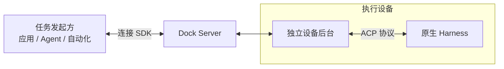

# harness-dock

**多种编程助手，同一种接入方式。**

应用发来任务，由设备上的编程助手执行，再把进度和结果传回来。Harness Dock 连接任务发起方与设备，复用助手的原生安装、登录和工具环境。

[下载 macOS 客户端](https://github.com/hutian-ai/harness-dock/releases/download/v0.1.0/harness-dock-panel-0.1.0-darwin-arm64.zip) · [文档站](https://hutian-ai.github.io/harness-dock/) · [版本说明](https://github.com/hutian-ai/harness-dock/releases/tag/v0.1.0)

## 它怎么工作

设备主动连接服务端，任务、权限确认和结果沿连接双向传递。应用负责业务交互与结果验收，原生助手负责执行与工具权限。

## 支持哪些助手

统一接入不同 Harness 是产品方向，当前安装包只包含 Codex。

| 编程助手（Harness） | 支持状态 |
| --- | --- |
| Codex | 已支持：macOS 13+、Apple Silicon |
| dsh | 计划接入 |
| zcode | 计划接入 |
| opencode | 计划接入 |

具体工具能力取决于原生环境和权限。完整平台与能力边界见[支持范围](https://hutian-ai.github.io/harness-dock/support/)。

## 开始使用

1. **安装客户端**：下载并解压 ZIP，将 `Harness Dock.app` 拖入“应用程序”目录，打开客户端。
2. **准备助手**：在这台 Mac 上安装并登录 Codex。
3. **连接设备**：打开管理员提供的邀请链接，在客户端核对服务地址并连接。
4. **测试并使用**：点击“测试 Codex”检查本机执行，再回到接入的应用发起任务。

客户端自带运行时和独立后台，设备接入通过面板完成。测试会使用一次模型请求额度，通过不代表全部工具均已验证。详细步骤见[安装指南](https://hutian-ai.github.io/harness-dock/installation/)。

当前为 **v0.1.0 Developer Alpha**，仅有 ad-hoc 签名，尚未完成 Developer ID 签名与 Apple 公证；安装限制见[版本说明](https://github.com/hutian-ai/harness-dock/releases/tag/v0.1.0)。

## 你想从哪里开始

- [把这台电脑接进来](https://hutian-ai.github.io/harness-dock/installation/)：安装客户端，用邀请链接连接设备。
- [把助手接进我的应用](https://hutian-ai.github.io/harness-dock/sdk/)：通过 TypeScript SDK 发任务、收结果。
- [自己部署连接服务](https://hutian-ai.github.io/harness-dock/server/)：在 Linux 上自托管服务端，连接应用与设备。

想了解选型？看[与助手自带远程功能的区别](https://hutian-ai.github.io/harness-dock/overview/#when-to-use)。

## 开发与贡献

源码构建和验证见[开发指南](https://hutian-ai.github.io/harness-dock/verification/)，深入了解 [架构](https://hutian-ai.github.io/harness-dock/architecture/) 与 [ACP 分层](https://hutian-ai.github.io/harness-dock/drivers/)。贡献约定见 [CONTRIBUTING.md](CONTRIBUTING.md)。

源码采用 [MIT](LICENSE)，依赖许可见[第三方说明](THIRD_PARTY_NOTICES.md)。workspace 包保持 private，未发布到 npm。安全问题按 [SECURITY.md](SECURITY.md) 私下报告。
