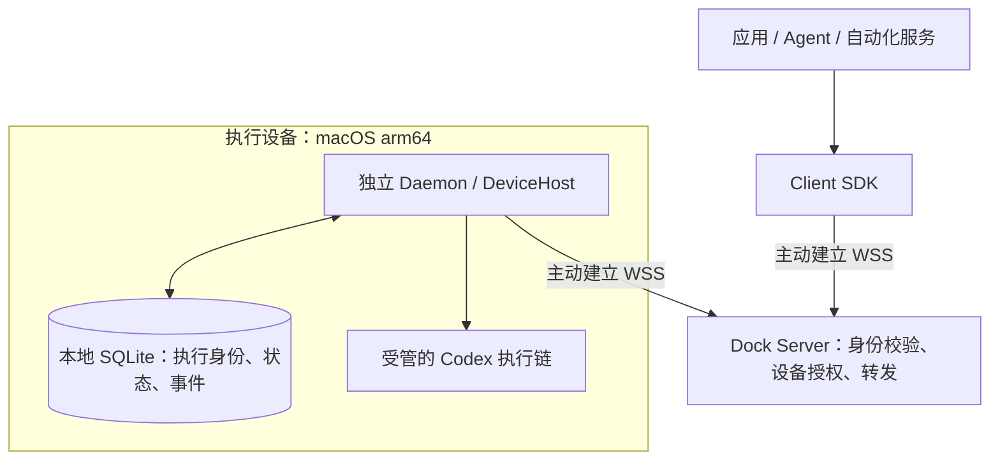
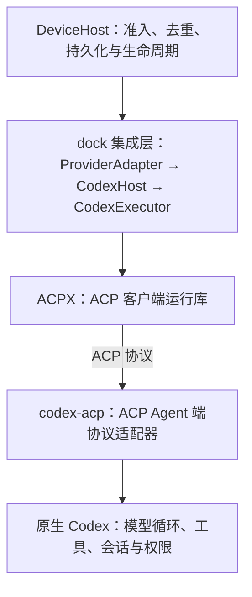

# harness-dock

harness-dock 是跨机器的原生 Harness 接入与执行基础设施。让应用、Agent 和自动化服务通过 TypeScript SDK，调用其他机器上已安装、已登录的原生 Harness。调用方可以发起任务、处理原生审批并读取结果。

每台设备运行独立 Daemon，设备与调用方主动连接自托管 server。调用方无需管理远程 Provider 进程、登录文件或设备上的工具安装。

**最小版本：仅支持 macOS arm64 设备上的 Codex。** server 可部署在 Linux。源码采用 MIT，当前为开发者 Alpha；设备用户可直接安装客户端，workspace package 保持 private，避免误发布到 npm。

[下载 macOS 客户端 v0.1.0](https://github.com/hutian-ai/harness-dock/releases/download/v0.1.0/harness-dock-panel-0.1.0-darwin-arm64.zip) · [版本说明与已知限制](https://github.com/hutian-ai/harness-dock/releases/tag/v0.1.0)

设备用户的默认路径是：安装客户端 → 登录原生 Codex → 打开邀请 → 连接这台 Mac → 点击“测试 Codex”。设备用户无需查找 JSON 文件；安装说明见[设备安装与维护](apps/docs-site/README.md#installation)，管理员生成步骤见[配对管理](apps/docs-site/README.md#pairing)。

## 从你的角色开始

| 你的目标 | 入口 | 完成标志 |
| --- | --- | --- |
| 把这台 Mac 接入已有服务 | [设备安装](apps/docs-site/README.md#installation) | 面板显示设备已连接，点击“测试 Codex”完成本机执行验证 |
| 让应用调用已授权的设备 | [执行与测试](apps/docs-site/README.md#usage)、[SDK](apps/docs-site/README.md#sdk) | 收到真实执行结果，按需验证审批与工具 |
| 部署和管理自托管服务 | [server](apps/docs-site/README.md#server)、[配对管理](apps/docs-site/README.md#pairing) | TLS、已加载配对和设备连接分别确认 |

设备用户按下方客户端流程完成接入。应用开发与服务部署的命令分别保留在 SDK、server 和开发者说明中。

## 开始使用

设备用户直接安装客户端即可，不需要 Git、Node.js、pnpm、源码构建或 JSON 配置。

1. **下载客户端**：下载 [v0.1.0 Developer Alpha（macOS arm64 ZIP）](https://github.com/hutian-ai/harness-dock/releases/download/v0.1.0/harness-dock-panel-0.1.0-darwin-arm64.zip)，也可在[版本说明](https://github.com/hutian-ai/harness-dock/releases/tag/v0.1.0)查看已知限制。
2. **安装并打开**：解压 ZIP，将 `Harness Dock.app` 拖入“应用程序”目录（或 `~/Applications`），双击打开。
3. **准备原生 Codex**：在这台 Mac 上安装并登录 Codex，保留原生安装与授权。
4. **连接这台 Mac**：打开管理员提供的邀请链接，点击“在 Harness Dock 中打开”；核对服务器后，点击“连接这台 Mac”。也可以在客户端粘贴邀请链接。已有设备直接使用检测到的原连接。
5. **点击“测试 Codex”**：客户端提交一次固定合成回显并显示通过、失败或结果待核对，以及最近检查时间。测试会使用一次模型请求额度，不需要打开终端或提供应用凭据。
6. **回到应用使用**：设备连接与本机测试确认后，在接入的应用中发起任务、处理原生审批并查看结果。

当前支持 macOS 13+、Apple Silicon + Codex。App 自带 Node 和独立 Daemon；首版为 Developer Alpha，仅完成本地 ad-hoc 签名，尚未完成 Developer ID 签名与公证。具体安装、维护与状态说明见[设备安装与维护](apps/docs-site/README.md#installation)。

服务器连接、本机模型执行和业务应用授权分别确认；本机测试通过不代表全部插件、桌面或浏览器工具已验证。关闭并重新打开面板只查询原测试，不会补发模型请求。

## 适用场景

- 应用需要使用另一台机器上已安装、已登录的 Codex。
- 一个控制端需要选择多台设备，读取能力并显式发起执行。
- 执行需要跨连接保持所有权，断线后按原身份查询结果。
- 调用方需要接收原生审批或提供本轮授权的 MCP 工具。

Harness 负责模型循环、工具、插件、skills、memory 和原生权限。dock 负责设备接入、执行身份、原生环境连接、审批路由和执行记录。业务授权、用户交互与结果验收由接入方实现。

## 组件



两条 WSS 箭头表示连接建立方向；连接建立后，请求、结果和回调双向传输。设备通常不需要开放公网入站端口。Server 负责认证和转发，执行进程与记录由设备 Daemon 持有。

| 组件 | 职责 |
| --- | --- |
| client | 连接 server、选择获授权设备、调用执行方法与处理回调 |
| server | 设备配对、应用访问范围、连接与请求转发 |
| daemon | 本机安装发现、执行准入、Provider 进程、状态与托管文件 |
| drivers | dock 的 Codex 集成层：环境选择、回调、事件与结果差异；调用 ACPX |
| protocol | 公共方法、类型、身份和传输限制 |

server 是受信任的转发节点，能够读取转发内容。远程连接使用校验证书的 TLS；明文 WS 仅用于回环地址。

### Codex 执行分层



**ACPX 在 `codex-acp` 上层，dock 集成层在 ACPX 上层。** 本仓库的 `packages/drivers` 命名指 dock 的集成代码；`codex-acp` 是独立依赖，负责实现 ACP 的 Agent 端。ACP 是协议，ACPX 是客户端运行库，两者职责不同。Driver 一词在本文指 dock 集成层，协议适配器明确称为 `codex-acp`。

Driver 和 ACPX 库运行在 Daemon 内；由 ACPX 管理的 `codex-acp` 接入所选本机 Codex。当前固定使用这条执行路径。调用方通过连接 SDK 使用设备，原生登录、配置与工具由设备上的 Harness 管理。代码对应关系与协议边界见 [Codex 集成与 ACP 分层](apps/docs-site/README.md#drivers)。

### 一轮执行与恢复

调用方先 `prepare`，再 `execute`。Daemon 在启动原生执行前，把 `runId` 和输入指纹持久化到本地 SQLite；同一身份与相同输入关联原执行，不同输入拒绝。集成层通过 ACPX 的 `ensureSession`、配置和 `startTurn` 接入 Codex，过程事件、原生审批和调用方工具请求通过 Server 回到应用。

终态以原生证据为准。确认结束后，调用方 `collect` 收存需要的输出，再 `release` 托管资源；业务结果仍由应用验收。应用断线不会自动结束设备执行，但依赖应用响应的工具或审批可能失败或被拒绝。重连只恢复连接与观察，不重发 prompt、工具调用或审批决定；按原 `runId` 查询 `getExecution` / `events`，必要时显式 `reconcile`。Daemon 重启后，未确认结束的记录保持 `unknown`，不自动恢复原进程。

部署架构、执行时序、身份与恢复规则见 [架构与执行契约](apps/docs-site/README.md#architecture)。

## 文档

- [快速开始](apps/docs-site/README.md#quickstart)：客户端安装、邀请接入与一键本机测试
- [执行与测试](apps/docs-site/README.md#usage)：一键本机测试、状态说明与高级应用侧验收
- [SDK](apps/docs-site/README.md#sdk)：方法、回调、执行身份与错误处理
- [server](apps/docs-site/README.md#server)：Linux 部署、TLS 与配对管理
- [设备维护](apps/docs-site/README.md#installation)：安装、自启、升级与回滚
- [架构](apps/docs-site/README.md#architecture)：职责、协议和扩展边界
- [Codex 集成与 ACP 分层](apps/docs-site/README.md#drivers)：dock 集成层、ACPX、codex-acp 与原生 Harness
- [支持范围](apps/docs-site/README.md#support)：平台、能力与限制
- [资源管理](apps/docs-site/README.md#lifecycle)：容量、保留与释放
- [验证](apps/docs-site/README.md#verification)：测试和真实执行的验收方法
- [构建与分发](apps/docs-site/README.md#distribution)：独立运行包、CI 和候选产物

## 首版交付范围

首版 **0.1.0 Developer Alpha** 包含：macOS arm64 + Codex、独立设备 Daemon、Linux server 和 TypeScript SDK。设备用户可从 [GitHub Release](https://github.com/hutian-ai/harness-dock/releases/tag/v0.1.0) 下载客户端，无需构建源码。客户端目前只有本地 ad-hoc 签名，Developer ID 签名与公证尚未完成；远端 CI、独立设备和具体工具能力的验证范围分别记录，不能由本机构建通过推定。

发布前按[首版验收清单](apps/docs-site/README.md#verification)核对源码检查、离线分发、真实 Codex、实际 GUI 和目标设备证据。原始配置、日志、截图和验证结果留在 ignored 的 `.local/`；公共文档只记录可复现方法与限制。

## 开发者与维护者

下面的命令用于源码开发、独立 server 部署和 SDK 集成。只使用客户端接入设备时，无需执行。

<details>
<summary>展开：从源码启动、完整链路示例与 SDK 接入</summary>

### 从源码启动

准备 Git、Node.js 22.19+；在执行设备原生安装、登录 Codex。先取得并构建源码：

```sh
git clone https://github.com/hutian-ai/harness-dock.git
cd harness-dock
npm install --global pnpm@12.15.0
pnpm install --frozen-lockfile
pnpm build
pnpm smoke:source
```

`smoke:source` 使用临时回环端口和隔离配置，禁用 Codex，不读取原生登录或调用模型。它验证源码 CLI/SDK 的连接和启停路径；真实设备仍需完成下列验收。

### 在一台 Mac 完成首次执行

以下命令均从仓库根目录运行；首次使用新的 `.local/quickstart` 目录。终端 1 初始化并启动本机 server：

```sh
pnpm server init .local/quickstart/control
pnpm server run .local/quickstart/control/server.json
```

终端 2 配对并启动独立 Daemon：

```sh
mkdir -p .local/quickstart/work
pnpm daemon init --cwd "$PWD/.local/quickstart/work" \
  --home "$PWD/.local/quickstart/device" \
  --pairing "$PWD/.local/quickstart/control/device-pairing.json"
pnpm daemon start .local/quickstart/device/config.json
pnpm daemon doctor .local/quickstart/device/config.json --json
pnpm client nodes .local/quickstart/control/client.json
pnpm client doctor .local/quickstart/control/client.json --probe --json
```

真实两轮测试会使用原生模型额度。测试由设备的授权应用通过 SDK 发起，server 负责转发。每台设备只有一个应用拥有者、每个应用身份只有一个活动连接：已有应用连接时应复用其 SDK 连接运行测试；下方 CLI 用于该身份未连接时的首次验收。不要另建客户端抢占既有设备，独立实验使用隔离的 server/设备身份。

基础测试可省略 `--approval`；加入该选项后，在交互终端展示原生选项，由你决定是否允许：

```sh
pnpm client test .local/quickstart/control/client.json --approval
pnpm daemon stop .local/quickstart/device/config.json
```

成功结果应包含 `state: completed`、`sameSessionVerified: true` 和 `approvalVerified: true`。测试失败时保存原 `runs`/runId，先查询 `pnpm client status <client.json> --node-id <设备UUID> --run-id <原runId>`；不要换身份重发来判断原结果。安装与协议 ready 不等于模型、桌面或浏览器已验收。

### 独立设备连接已有 server

在独立 Mac 上完成上面的 clone、依赖安装、构建和源码冒烟。由 server 管理者为这台设备创建独立身份、授权给应用并加载配置，然后安全提供该设备专属的 `device-pairing.json`（含已配置的 WSS 入口）。只把这份文件保存为 `.local/device-pairing.json`，再执行：

```sh
mkdir -p "$HOME/harness-work"
chmod 600 .local/device-pairing.json
pnpm daemon init --cwd "$HOME/harness-work" \
  --home "$PWD/.local/home-device" --pairing "$PWD/.local/device-pairing.json"
pnpm daemon start .local/home-device/config.json
pnpm daemon doctor .local/home-device/config.json --json
pnpm daemon status .local/home-device/config.json
```

若使用私有 CA，在 `init` 增加 `--ca-file /absolute/trusted-ca.pem`。原生 Codex 使用这台 Mac 当前用户自己的安装与登录；设备凭据和应用 `client.json` 分别授权，不混用。持有该设备拥有者应用凭据的控制端，在该应用身份没有其他活动连接时，按 `status` 返回的 nodeId 执行：

```sh
pnpm client doctor /private/client.json --node-id <设备UUID> --probe --json
pnpm client test /private/client.json --node-id <设备UUID> --approval
```

源码后台启动不注册登录自启。登录自启、版本化安装和升级回滚见 [设备维护](apps/docs-site/README.md#installation)；跨机器 server 的 TLS、配对和加载确认见 [server 指南](apps/docs-site/README.md#server)。更新源码前先确认无活动或 unknown 执行，再通过原入口停机；不在运行中的源码目录重装依赖或构建。

### 应用接入 SDK

SDK 通过随候选包提供的归档安装：

```sh
npm install --offline --ignore-scripts --no-audit --no-fund /absolute/harness-dock-sdk-0.1.0.tgz
```

```ts
import { ServerClient, loadClientOptions } from '@harness-dock/client';

const client = new ServerClient(await loadClientOptions('.local/client.json'));
await client.ready;
console.table(client.listNodes());
await client.close();
```

完整执行、审批和恢复示例见 [SDK 指南](apps/docs-site/README.md#sdk)。

</details>

### 开发与验证命令

```sh
npm install --global pnpm@12.15.0
pnpm install --frozen-lockfile
pnpm check
pnpm smoke:source
```

真实 Codex 验收需要本机登录及模型额度，显式执行 `pnpm accept:codex`。其他命令与贡献约定见 [CONTRIBUTING.md](CONTRIBUTING.md)。

代码采用 [MIT](LICENSE)，依赖许可见 [第三方说明](THIRD_PARTY_NOTICES.md)。安全问题按 [SECURITY.md](SECURITY.md) 私下报告。

## 产品文档站

面向使用者的产品介绍、安装、使用与 SDK 指南位于 [`apps/docs-site/`](apps/docs-site/README.md)。本地运行 `node apps/docs-site/build.mjs` 后执行 `node apps/docs-site/serve.mjs` 预览；GitHub Pages 配置与首次启用条件见文档站说明。
