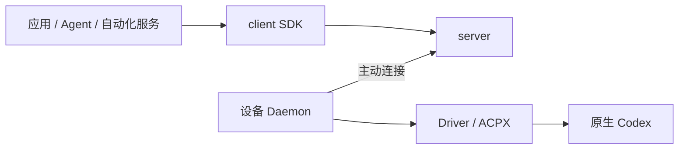

# harness-dock

harness-dock 是跨机器的原生 Harness 接入与执行基础设施。应用、Agent 和自动化服务通过 TypeScript SDK 连接设备，在目标机器的原生环境中执行任务、处理审批并读取结果。

每台设备运行独立 Daemon，设备与调用方主动连接自托管 server。调用方无需管理远程 Provider 进程、登录文件或设备上的工具安装。

**最小版本：仅支持 macOS arm64 设备上的 Codex。** server 可部署在 Linux；项目处于开发者 Alpha，采用私有源码与候选运行包分发，尚无 npm registry 发布。

## 适用场景

- 应用需要使用另一台机器上已安装、已登录的 Codex。
- 一个控制端需要选择多台设备，读取能力并显式发起执行。
- 执行需要跨连接保持所有权，断线后按原身份查询结果。
- 调用方需要接收原生审批或提供本轮授权的 MCP 工具。

Harness 负责模型循环、工具、插件、skills、memory 和原生权限。dock 负责设备接入、执行身份、原生环境连接、审批路由和执行记录。业务授权、用户交互与结果验收由接入方实现。

## 组件



| 组件 | 职责 |
| --- | --- |
| client | 连接 server、选择获授权设备、调用执行方法与处理回调 |
| server | 设备配对、应用访问范围、连接与请求转发 |
| daemon | 本机安装发现、执行准入、Provider 进程、状态与托管文件 |
| drivers | 原生环境选择与具名协议适配；当前使用 ACPX / Codex ACP |
| protocol | 公共方法、类型、身份和传输限制 |

server 是受信任的转发节点，能够读取转发内容。远程连接使用校验证书的 TLS；明文 WS 仅用于回环地址。

## 开始使用

准备 Node.js 22.19+，并在执行设备安装、登录 Codex。使用预构建运行包时不需要 Git 或 pnpm。

1. 按 [快速开始](apps/docs-site/README.md#quickstart) 初始化 server、配对设备并完成首次执行。
2. 按 [SDK 指南](apps/docs-site/README.md#sdk) 将设备接入自己的应用。
3. 跨机器运行时，配置 [Linux server 与 WSS](apps/docs-site/README.md#server)。

SDK 通过随候选包提供的归档安装：

```sh
npm install --offline --ignore-scripts --no-audit --no-fund /absolute/harness-dock-sdk-0.1.0.tgz
```

```ts
import { ServerClient, loadClientOptions } from '@harness-dock/client';

const client = new ServerClient(await loadClientOptions('.local/client.json'));
await client.ready;
console.table(client.listNodes());
await client.close();
```

完整执行、审批和恢复示例见 [SDK 指南](apps/docs-site/README.md#sdk)。

## 文档

- [快速开始](apps/docs-site/README.md#quickstart)：本机闭环与首次验证
- [SDK](apps/docs-site/README.md#sdk)：方法、回调、执行身份与错误处理
- [server](apps/docs-site/README.md#server)：Linux 部署、TLS 与配对管理
- [设备维护](apps/docs-site/README.md#installation)：安装、自启、升级与回滚
- [架构](apps/docs-site/README.md#architecture)：职责、协议和扩展边界
- [支持范围](apps/docs-site/README.md#support)：平台、能力与限制
- [资源管理](apps/docs-site/README.md#lifecycle)：容量、保留与释放
- [验证](apps/docs-site/README.md#verification)：测试和真实执行的验收方法
- [构建与分发](apps/docs-site/README.md#distribution)：独立运行包、CI 和候选产物

## 从源码开发

```sh
npm install --global pnpm@12.15.0
pnpm install --frozen-lockfile
pnpm check
```

真实 Codex 验收需要本机登录及模型额度，显式执行 `pnpm accept:codex`。其他命令与贡献约定见 [CONTRIBUTING.md](CONTRIBUTING.md)。

代码采用 [MIT](LICENSE)，依赖许可见 [第三方说明](THIRD_PARTY_NOTICES.md)。安全问题按 [SECURITY.md](SECURITY.md) 私下报告。

## 产品文档站

面向使用者的产品介绍、安装、使用与 SDK 指南位于 [`apps/docs-site/`](apps/docs-site/README.md)。本地运行 `node apps/docs-site/build.mjs` 后执行 `node apps/docs-site/serve.mjs` 预览；GitHub Pages 配置与首次启用条件见文档站说明。
