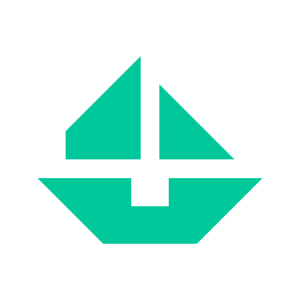
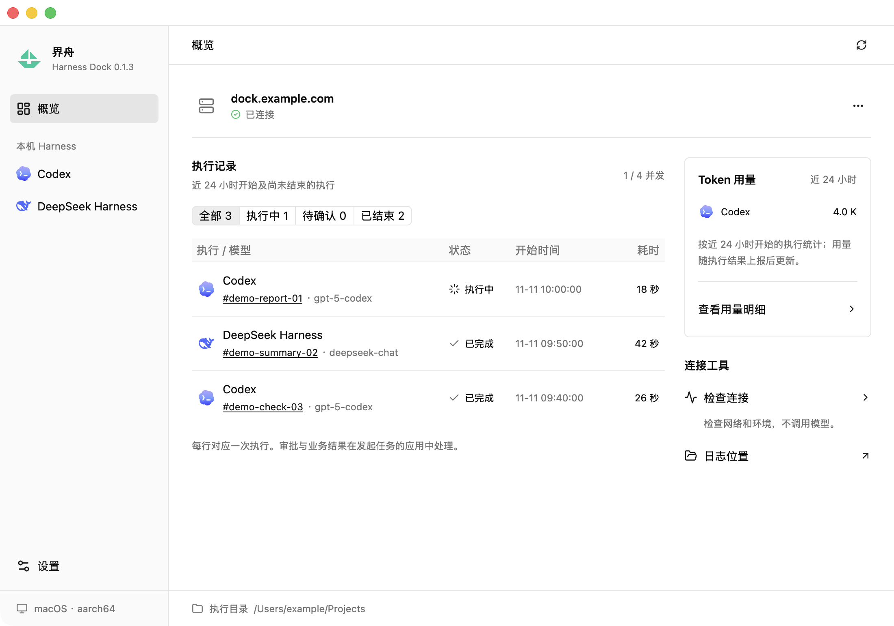
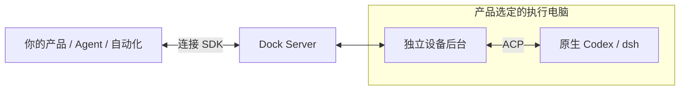

# 界舟 · Harness Dock



**让你的产品，调用其他电脑上已有的 Codex 与 DeepSeek Harness。**

产品通过 SDK 选择设备并发起任务；所选电脑上的原生 Harness 执行任务，进度、原生审批和结果回到产品。用户已有的安装、登录、模型配置与工具留在执行电脑上。

[产品文档](https://hutian-ai.github.io/harness-dock/) · [下载 macOS App v0.1.3](https://github.com/hutian-ai/harness-dock/releases/download/v0.1.3/harness-dock-panel-gpui-0.1.3-darwin-arm64.zip) · [Windows 安装程序](https://github.com/hutian-ai/harness-dock/releases/download/v0.1.3-windows.1/harness-dock-panel-gpui-0.1.3-windows.1-windows-x64-setup.exe) · [Windows 便携 ZIP](https://github.com/hutian-ai/harness-dock/releases/download/v0.1.3-windows.1/harness-dock-panel-gpui-0.1.3-windows.1-windows-x64.zip)

<a href="https://hutian-ai.github.io/harness-dock/app/"></a>

*macOS App v0.1.3 · 演示数据。查看这台电脑上的执行状态与已上报用量；任务发起、审批与结果验收在你的产品中完成。*

## 从你想做的事开始

| 你想做什么 | 从哪里开始 |
| --- | --- |
| 给应用、Agent 或自动化流程接入原生执行 | [SDK：完成第一个任务](https://hutian-ai.github.io/harness-dock/sdk/#quick-connect) |
| 把 Mac 连接给远端产品使用 | [App：安装与连接](https://hutian-ai.github.io/harness-dock/quickstart/) |
| 把 Windows 11 x64 连接给远端产品使用 | [Windows 安装与连接](https://hutian-ai.github.io/harness-dock/installation/#windows-install) |
| 为应用和电脑准备共同的连接服务 | [管理员：部署 Server](https://hutian-ai.github.io/harness-dock/server/) |

例如，在产品里加入“生成报告”：产品选择一台获授权的电脑，提交任务，由那里的 Harness 使用已有工具处理资料，再接回报告并验收。具体工具能力取决于执行电脑上的原生环境与权限。

## 它如何工作



同一个 Server 可以连接多台电脑，由调用方选择本次设备。设备主动连接 Server，无需为电脑开放公网入站端口；远程连接使用经过验证的 TLS。

Dock 提供设备接入与执行管理。产品负责业务界面、业务授权和结果验收；Harness 负责模型、工具及原生权限。关闭 App 界面不停止独立后台，断线也不会自动重派任务。缺少完成证据时保留待确认状态。

如果你只是自己远程使用一个 Harness，可以先看它的原生远程入口；如果产品已有设备连接与进程管理，也可直接集成原生 SDK。[进一步判断是否适合用 Dock](https://hutian-ai.github.io/harness-dock/overview/)。

## 下载与当前版本

**macOS 与 Windows 11 x64 均可直接下载。** Windows 安装程序按当前用户安装，提供开始菜单入口与卸载，也可选择便携 ZIP。Windows 和 macOS、SDK 分别发行。

| 发行 | 用途与支持范围 |
| --- | --- |
| **App v0.1.3 · Developer Alpha** | GPUI 桌面客户端，macOS **15+、Apple 芯片**；Codex 已支持，dsh 实验适配。 |
| [Windows v0.1.3-windows.1 · Developer Alpha](https://github.com/hutian-ai/harness-dock/releases/tag/v0.1.3-windows.1) | Windows 11、Intel/AMD x64；安装程序和便携 ZIP，自带 Node.js 与独立后台。 |
| [旧 App v0.1.2](https://github.com/hutian-ai/harness-dock/releases/tag/v0.1.2) | Swift 菜单栏客户端，macOS 13+、Apple 芯片。 |
| [SDK sdk-v0.1.2](https://github.com/hutian-ai/harness-dock/releases/tag/sdk-v0.1.2) | 独立的 Node.js 连接 SDK、Server 与 macOS arm64 设备 CLI；需要 Node.js 22.19+。 |

App 自带运行时与设备后台，无需 Git、pnpm 或自行构建。原生 Codex/dsh 仍需在执行电脑上安装并登录。App 采用 ad-hoc 签名，尚未完成 Developer ID 签名与 Apple 公证；首次打开限制见[常见问题](https://hutian-ai.github.io/harness-dock/troubleshooting/)。

Windows 11 x64 提供 Developer Alpha 安装程序和便携 ZIP，可在窗口中粘贴设备邀请或选择配对文件；控制链路、Codex/dsh 真实执行和本地窗口已有分别验收记录。Windows 程序尚未代码签名，需 Microsoft Visual C++ x64 运行库；登录自启、链接协议注册和单实例激活尚未提供。macOS Intel 与 Linux 执行设备未支持。Linux 可部署 Server。[完整支持范围](https://hutian-ai.github.io/harness-dock/support/)。

Windows daemon 源码可在 Node.js 22.19+、pnpm 12.15.0 下构建。运行 `pnpm install --frozen-lockfile` 后执行 `pnpm check:windows`，检查 NTFS 权限、命名管道鉴权、后台启停、升级回滚、长路径会话存储和 SDK 连通性。此检查不调用模型；真实执行另跑 `pnpm accept:codex` / `pnpm accept:dsh`。已验收环境使用 Node.js 24.22.1；dsh 0.2.2-rc.1 要求 Node.js 24.9+。PowerShell 使用步骤见[Windows daemon 源码](https://hutian-ai.github.io/harness-dock/installation/#windows-daemon)。

## App v0.1.3 有什么

- **概览**：未连接时接入服务器；连接后查看独立编号的执行记录、并发状态和各 Harness 已上报的 Token 用量。
- **Harness 详情**：查看安装、原生会话默认配置和可用模型；需要时手动测试响应。内容只读，默认值包含本机原生配置覆盖，不保证等于官方出厂默认。
- **连接工具**：查看诊断结论，或在 Finder 定位日志；诊断不调用模型。
- **设置**：外观与登录后自动连接。当前连接的启动、停止和移除在概览中管理。

执行快照最多 50 条，按近 24 小时开始及尚未结束的执行统计；不是完整历史分页。用量只计通过本机 Dock 执行且已上报的记录，“未上报”不是零。正常可见窗口约每 10 秒刷新，测试或待核对测试收据约每 2 秒；模型目录需单独读取。

dsh 可以使用自定义模型供应方。界面展示模型名称与供应方，执行保留原始模型标识；当前 dsh ACP 不提供权限模式查询，权限由原生 Harness 管理，审批在调用方处理。Codex 响应测试使用原生只读模式；dsh 测试沿用原生权限、不提供只读保证。测试会使用模型额度。

替换 App 不会自动升级已有后台；需要新版后台能力时，在设备空闲且没有待核对任务时显式更新。首次连接、日常操作和更新说明集中在 [App 使用指南](https://hutian-ai.github.io/harness-dock/app/)。

## 开发与贡献

使用 TypeScript ESM、Node.js 22.19+ 与 pnpm 12.15.0；桌面客户端使用 Rust 和固定 GPUI Kit 0.9.0。

```sh
pnpm install --frozen-lockfile
pnpm check
pnpm smoke:source
```

[贡献指南](CONTRIBUTING.md) · [架构](https://hutian-ai.github.io/harness-dock/architecture/) · [驱动与 ACP](https://hutian-ai.github.io/harness-dock/drivers/) · [验证方法](https://hutian-ai.github.io/harness-dock/verification/) · [构建与分发](https://hutian-ai.github.io/harness-dock/distribution/)

当前源码另有尚未通过独立 SDK Release 分发的 `onReceipt / progress / signal` 与显式 `collect / release`，见 [SDK 源码能力](https://hutian-ai.github.io/harness-dock/sdk/#source-observation)。不要把它们当作 sdk-v0.1.2 下载内容。

源码采用 [MIT](LICENSE)，依赖保留各自许可，见 [第三方说明](THIRD_PARTY_NOTICES.md)。workspace 包保持 private，不发布到 npm。配置、凭据、日志和验证原始数据留在 ignored `.local/`。安全问题按 [SECURITY.md](SECURITY.md) 私下报告。
